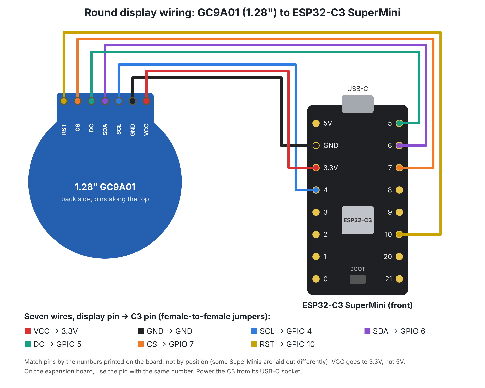

# LD2450 round display (ESP32-C3 SuperMini + 1.28" GC9A01)

A small, wireless second screen for the HLK-LD2450 radar. It joins your home Wi-Fi, finds the
radar ESP32 (`esp32-radar-display/`) by itself and shows the people it tracks on the round
display:

- a top-down 120° radar fan with rings every metre (labelled at 2 m and 4 m);
- a coloured dot per person (1 cyan, 2 yellow, 3 magenta) with a short trail and its distance;
- the number of people and the nearest distance at the top, the update rate at the bottom.

The radar ESP32 does not need any change: the round display reads the same live data as the
browser page (`ws://<radar ip>:81/`). It only works on the home network, not through EMQX.

## Parts and wiring

- ESP32-C3 **SuperMini** (on its expansion board, or on its own)
- 1.28" round **GC9A01** display, 240 × 240, 7 pins (`RST CS DC SDA SCL GND VCC`)
- 7 female-to-female jumper wires, and a USB-C cable for power

| Display pin | C3 SuperMini pin |
|---|---|
| VCC | **3.3V** (not 5V) |
| GND | **GND** |
| SCL | **GPIO 4** |
| SDA | **GPIO 6** |
| DC | **GPIO 5** |
| CS | **GPIO 7** |
| RST | **GPIO 10** |



Match pins by the numbers printed on the board. These pins avoid GPIO 2, 8 and 9 (they decide
how the C3 starts; 8 is also the blue LED and 9 the BOOT button) and GPIO 18/19 (USB).
The display has no backlight pin; its backlight is always on.

## Flashing (Chrome or Edge on Windows, nothing to install)

1. Open the repository's **Actions** tab → **ESP32-C3 round display firmware** → the latest
   green run.
2. Under **Artifacts**, download **esp32-c3-round-display-firmware** and unzip it.
3. Plug the SuperMini into the PC with a USB-C data cable.
4. In Chrome or Edge open `https://espressif.github.io/esptool-js/`, click **Connect** and pick
   the port called **USB JTAG/serial debug unit** (not a CP210x port: the C3 has USB built in).
   - If no port appears or connecting fails: unplug the C3, **hold BOOT**, plug it back in,
     release BOOT, and click **Connect** again.
5. Add the file **`round-display-merged.bin`** at flash address **`0x0`**, then click
   **Program**.
6. When it's done, unplug and replug the C3 (or press its **RST** button).

## First start: Wi-Fi setup

1. The display shows **Wi-Fi setup** with a hotspot name like `LD2450-Round-AB12` and a
   password.
2. On your phone, join that hotspot with the password shown. The setup page usually opens by
   itself; if not, browse to `192.168.4.1`.
3. Tap **Configure WiFi**, pick your home network (the same one the radar ESP32 is on), type
   its password and **Save**.
   - **Radar address** can stay blank: the display finds the radar automatically. If it never
     finds it, type the radar's IP address shown on the big display (e.g. `192.168.1.243`).
4. The display shows **Wi-Fi → Radar: Connecting** and then the live radar.

To change Wi-Fi or the radar address later, **hold BOOT for 3 seconds**. The setup hotspot
opens again (with a new password) and closes by itself after 5 minutes.

## What the screen messages mean

| Message | Meaning / what to do |
|---|---|
| **Wi-Fi setup** | Waiting for you to set up Wi-Fi (see above). |
| **Wi-Fi: Connecting...** | Joining your home Wi-Fi. If it stays here, see *Troubleshooting*. |
| **Radar: Searching...** | On Wi-Fi, but no radar found. Is the radar ESP32 powered and on the same Wi-Fi? |
| **Radar: Connecting to ...** | Found the radar, connecting. |
| **No radar data** | Connected to the radar ESP32, but it is not sending positions (check the radar itself). |

## Troubleshooting

- **Screen stays black:** check VCC → 3.3V and GND, then SCL/SDA (GPIO 4/6). The backlight
  should light up as soon as the board has power.
- **Screen is lit but shows nothing / garbage:** check DC (GPIO 5), CS (GPIO 7), RST (GPIO 10).
- **Never gets past "Wi-Fi: Connecting":** many SuperMinis have a weak antenna and can't join
  Wi-Fi at full power, so this firmware already uses a lower power (8.5 dBm). Move it closer to
  the router to test. `kWifiTxPower` in `src/config.h` changes it.
- **Picture turned the wrong way:** change `kScreenRotation` in `src/config.h` (0 to 3).
- **People on the wrong side (left/right):** that is set on the radar ESP32 (`kMirrorX` in
  `esp32-radar-display/src/config.h`); this display, the browser page and the app all follow it.
- **Serial log:** connect at 115200 baud (e.g. the esptool-js page's console) to see what it is
  doing (Wi-Fi, which radar it found, connection lost, ...).

## For developers

PlatformIO project (Arduino on ESP32-C3, `espressif32@6.9.0`). It reuses the radar library
from `../esp32-radar-display/lib` (`LD2450`, `RadarJson` incl. `decodeFrameJson`, which is
unit-tested there with `pio test -e native`).

```
pio run                      # build
pio run -t upload            # flash over USB
pio device monitor           # serial log
```

| Path | Contents |
|---|---|
| `src/main.cpp` | Wi-Fi + setup hotspot, finding the radar (mDNS `_ld2450._tcp`), WebSocket client |
| `src/RoundView.*` | Drawing on the round display |
| `src/config.h` | Settings you may want to change |
| `docs/wiring.svg` / `.png` | Wiring diagram |

How it finds the radar, in order: the address typed into the setup page (IP, or a name such as
`ld2450-ab12.local`) → the radar it found last time → an mDNS search for `_ld2450._tcp`. If a
radar stops answering for 15 seconds, it searches again (the radar's IP may have changed).

CI (`.github/workflows/esp32-c3-round-display.yml`) builds the firmware and the single image
`round-display-merged.bin` for address 0x0.
