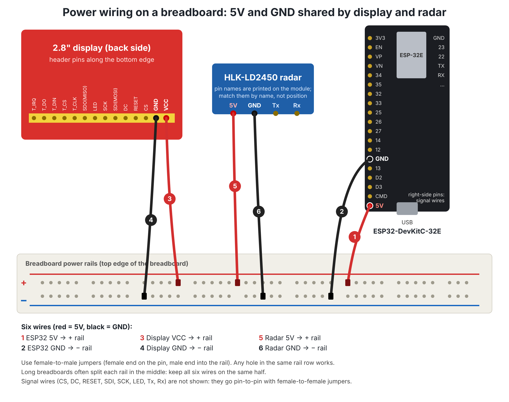

# ESP32 radar display (small screen)

**This folder is only the firmware for the ESP32 and the 2.8" display.**
The Android viewer app comes later and will live in its own folder.

Shows people detected by the HLK-LD2450 radar live on the 2.8" display:

- **Top bar:** radar firmware version, how many people are detected, and the update rate
  (about 10 Hz). Shows **NO DATA** in red if the radar stops sending.
- **Middle:** top-down view. The radar is the white triangle at the bottom. The green fan is
  its ±60° field of view, with rings every metre out to 6 m. Each person is a numbered
  coloured dot (1 cyan, 2 yellow, 3 magenta) with a fading trail.
- **Bottom:** one row per person: distance, angle (0° = straight ahead) and speed.

## Hardware

- ESP32-DevKitC-32E (ESP32-WROOM-32E)
- HLK-LD2450 radar
- 2.8" SPI TFT 240×320, ILI9341 (touch not used)
- Micro-USB **data** cable (some cables only charge)

## Wiring

| From | To ESP32 pin (as labelled on the board) |
|---|---|
| Radar 5V | 5V |
| Radar GND | GND |
| Radar Tx | 16 |
| Radar Rx | 17 |
| Display VCC | 5V |
| Display GND | GND |
| Display CS | 22 |
| Display RESET | 4 |
| Display DC | 21 |
| Display SDI(MOSI) | 23 |
| Display SCK | 18 |
| Display LED | 32 |
| Display SDO(MISO) | not connected |
| Display T_IRQ, T_DO, T_DIN, T_CS, T_CLK | not connected (touch not used) |

Both 5V wires go to the same 5V pin, so join them on a breadboard rail. Any GND pin works.



Leave the J1 pads on the back of the display open.

## Three ways to flash

| | Needs | Best for |
|---|---|---|
| **1. One-click flasher page** (main method) | Chrome or Edge | Installing the latest build: open a link, click Install |
| **2. GitHub build + Espressif web flasher** (backup) | Chrome or Edge | If the flasher page is unavailable |
| **3. PlatformIO** (below) | VS Code + PlatformIO | Changing settings or code yourself |

### 1. One-click flasher page (main method)
Open **https://crickplayer.github.io/FieldTimestampCam/** in Chrome or Edge on a computer,
plug in the ESP32, click **Install firmware**, pick the **CP210x** port and confirm.
GitHub Actions rebuilds the firmware and republishes this page on every change to `main`.
The page source is `web-flasher/index.html`.

One-time setup on GitHub: **Settings → Pages → Build and deployment → Source: GitHub Actions.**
The page then publishes on the next push to `main`, or when you run
**Actions → ESP32 radar display firmware → Run workflow** on `main`.

### 2. GitHub build + Espressif web flasher (backup)
1. Open the repository's **Actions** tab → **ESP32 radar display firmware** → the latest green run.
2. Under **Artifacts**, download **esp32-radar-display-firmware** and unzip it.
3. In Chrome or Edge open `https://espressif.github.io/esptool-js/`, click **Connect** and
   pick the **CP210x** port.
4. Add the file **`radar-display-merged.bin`** at flash address **`0x0`**, then click **Program**.
5. When it's done, press **EN** on the ESP32.

### 3. PlatformIO on Windows 10/11

1. **Install VS Code** from code.visualstudio.com.
2. In VS Code, open **Extensions** (Ctrl+Shift+X), search for **PlatformIO IDE**, install it,
   and restart VS Code when asked. The first start takes a few minutes while it downloads tools.
3. **USB driver:** plug in the ESP32 and open **Device Manager → Ports (COM & LPT)**. You
   should see *Silicon Labs CP210x USB to UART Bridge (COMx)*. If not, install the driver
   from `docs/hlk-ld2450/common software/Serial port driver.zip` (folder `CP210x_Windows_Drivers`,
   run `CP210xVCPInstaller_x64.exe`), then replug.
4. **Get the code:** download the repository from GitHub (Code → Download ZIP, on branch
   `ccr-7b0e112a-ekzu5e`) and unzip it.
5. In VS Code: **File → Open Folder…** and choose the **`esp32-radar-display`** folder
   (this folder, not the repository root).
6. Click the **→ (Upload)** arrow in the blue status bar at the bottom. PlatformIO downloads
   the ESP32 tools and the display library the first time, then builds and flashes.
   If it stops at `Connecting....`, hold the **Boot** button on the ESP32 until it continues.
7. Click the **plug icon (Serial Monitor)** in the status bar to see debug output.

## Wi-Fi, phone and remote viewing

The ESP32 joins your Wi-Fi so phones can watch live: directly on your home network, and from
anywhere through your MQTT broker (EMQX Cloud). **No passwords are stored in this repository.**
You type them into the ESP32's own setup page, and the ESP32 keeps them in its flash memory.

### 1. Prepare EMQX (once, in the EMQX Cloud console)
1. Open your deployment's **Overview** and note the **connection address** (it ends in
   `.emqxsl.com` on Serverless) and the **MQTT over TLS port** (normally **8883**).
2. Under **Access Control → Authentication**, add two users with strong passwords:
   one for the ESP32 (e.g. `ld2450-device`) and one for the phone app (e.g. `ld2450-viewer`).

### 2. Connect the ESP32 to Wi-Fi
1. On first start (or after holding **BOOT** for 3 seconds) the bottom of the screen shows
   `Wi-Fi setup: join hotspot LD2450-XXXX` and a **password**.
2. On your phone, join that Wi-Fi hotspot with that password. A setup page opens (if not,
   browse to `192.168.4.1`).
3. Tap **Configure WiFi**, pick your home network and enter its password.
4. Fill in the MQTT fields: broker address, port `8883`, the ESP32's username and password,
   encrypted `1`. Leave the broker address blank for home-network-only use.
5. Tap **Save**. The hotspot closes, the ESP32 joins your Wi-Fi, and the top bar shows its IP
   address.

The radar view keeps running on the screen during setup.

### 3. Watch it
- **Home network, any browser:** open `http://<IP shown on the screen>/`.
- **Android app:** coming next; it connects on the home network and through EMQX when away.

### Top bar indicators
| Indicator | Grey | Yellow | Green | Cyan |
|---|---|---|---|---|
| **WiFi** | Not connected | Setup hotspot open | Connected | — |
| **Cloud** | No broker set | Connecting / failed (retries every 15 s) | Connected | A remote viewer is watching |

### What goes over the network
- `ws://<ip>:81/` (home network): live JSON frames about 10 times a second, e.g.
  `{"v":1,"seq":42,"targets":[{"id":1,"x":-782,"y":1713,"speed":-16}]}`
  (x, y in mm; speed in cm/s; x already mirrored if `kMirrorX` is set). The first message
  on connect is a status message (`"type":"status"`, device id, radar firmware, IP).
- MQTT topics, where `<id>` is e.g. `ld2450-35f4` (shown in the browser page and on the serial
  monitor):

| Topic | Direction | Content |
|---|---|---|
| `ld2450/<id>/status` | ESP32 → viewers | Retained status message, `"state":"online"` or `"offline"` (set by the broker if the ESP32 drops off) |
| `ld2450/<id>/targets` | ESP32 → viewers | The same frames as the WebSocket, **only while someone is watching** |
| `ld2450/<id>/watch` | viewers → ESP32 | Any message; the ESP32 streams for 60 s after each one, so a viewer sends one every ~30 s |

Streaming only while watched (and at most once a second when the room is empty) keeps cloud
traffic low. Continuous 10 Hz streaming would be roughly 4 GB a month.

The home-network page and stream have no password: anyone on your Wi-Fi can view them.
Remote access always goes through EMQX with TLS and your EMQX users.

## What you should see

1. "LD2450 RADAR / Connecting to radar..." for about a second.
2. The green fan with the top bar showing e.g. `V2.04.23101915` and `0 people 10.0 Hz`.
3. Walk in front of the radar: a dot appears and follows you.

Serial monitor (115200 baud):
```
[boot] LD2450 radar display
[radar] firmware V2.04.23101915
[radar] tracking mode: multi target
[radar] Bluetooth already off (radar 8f272eb80f65)
T1 x= -782 y= 1713 mm  d=1.88m  a=-24.5deg  v= -16cm/s   T2 --   T3 --
```

## Troubleshooting

| Symptom | Check |
|---|---|
| Screen stays white or black | Display wiring (CS 22, DC 21, RESET 4, SDI 23, SCK 18), VCC to 5V |
| Backlight on but no picture | SDI/SCK swapped, or CS/DC swapped |
| Red **NO DATA** | Radar Tx → **16**, radar 5V and GND. The radar needs >200 mA, so use a good USB port or cable |
| Serial: `no reply to 'enable configuration'` but the dots work | Radar Rx ← **17** (only needed to read firmware/settings) |
| People appear on the wrong side when you walk left/right | Set `kMirrorX = true` in `src/config.h` |
| Picture upside down | Set `kScreenRotation = 3` in `src/config.h` |
| Upload fails / no COM port | Data cable, CP210x driver, hold **Boot** while it says `Connecting` |

## Settings

Change these in `src/config.h`: mirror left/right, screen rotation, trail length, timeout,
serial debug output.

**Radar Bluetooth is turned off** (`kRadarBluetooth = false`). The project doesn't use it,
and it has no password, so anyone nearby with Hi-Link's app could otherwise change the radar's
settings. The radar's external antenna is only for that Bluetooth, so it isn't needed.
The radar has no command to read the Bluetooth state, so the ESP32 remembers per radar
(by its MAC address) that it applied the setting. The first start with a new radar, or after
changing the setting, shows "Turning radar Bluetooth off..." and restarts the radar once.
Later starts skip it. Set `kRadarBluetooth = true` to turn it back on. Display pins are in `platformio.ini` (`build_flags`).

## Code layout

| Path | What it does |
|---|---|
| `lib/LD2450/` | Radar protocol: decodes radar frames and builds commands. Plain C++ with no ESP32 code, so it is unit-tested on a PC and is the reference for the Android app's decoder later |
| `src/main.cpp` | Reads the radar on UART2 and drives the screen |
| `src/RadarView.*` | Everything drawn on the display |
| `src/RadarNetwork.*` | Wi-Fi setup hotspot, home-network page and stream, MQTT (runs on the second CPU core) |
| `src/WebPage.h` | The live view page served on the home network |
| `src/RootCAs.h` | Root certificates for the encrypted MQTT connection |
| `src/config.h` | User settings |
| `web-flasher/` | The one-click browser flasher page (published to GitHub Pages by CI) |
| `test/` | Protocol tests using the vendor's example data: `pio test -e native` |

GitHub Actions (`.github/workflows/esp32-radar-display.yml`) runs the tests and builds the
firmware on every push that touches this folder. The build output includes
`radar-display-merged.bin`, a single image that can be flashed at address 0x0.
